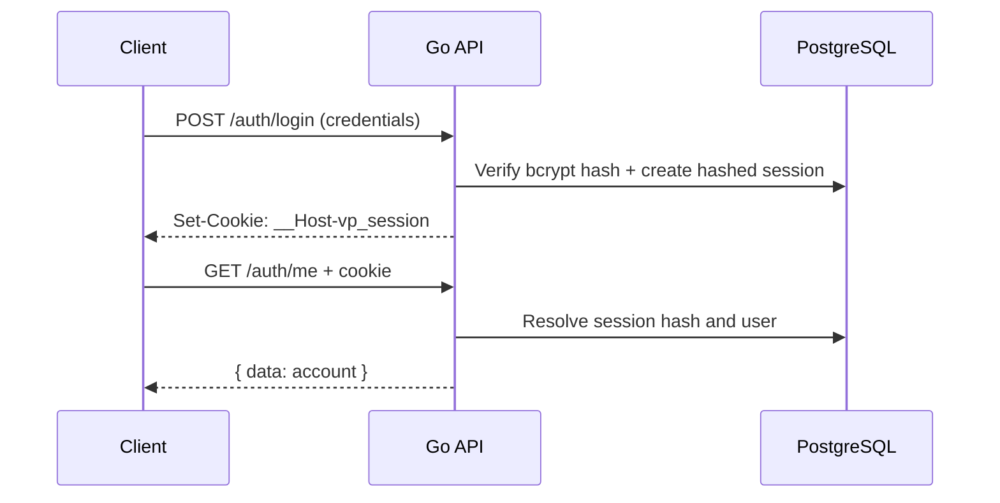

# Authentication and identity

Identity is local to the VPK PostgreSQL-backed API. Passwords are bcrypt hashes. Verification and reset tokens are random, single-use secrets; token hashes are stored. Verification messages are currently written to a local outbox for development. No outbound email delivery provider is implied.

| Method + path | Body | Behavior |
| --- | --- | --- |
| `POST /api/v1/auth/register` | email, password | Creates account and queues verification; account is not usable before verification |
| `POST /api/v1/auth/login` | email, password | Establishes session |
| `POST /api/v1/auth/verify-email` | token | Consumes token and marks email verified |
| `POST /api/v1/auth/verification/request` | email | Requests another verification message with privacy-preserving response |
| `POST /api/v1/auth/password-reset/request` | email | Queues reset token without confirming account existence |
| `POST /api/v1/auth/password-reset/confirm` | token, new_password | Changes password and revokes existing sessions |
| `POST /api/v1/auth/logout` | none | Revokes current session |
| `POST /api/v1/auth/logout-all` | none | Revokes all account sessions |
| `GET /api/v1/auth/me` | none | Returns current signed-in account |

Exact field constraints are enforced in request handlers. Check those handlers when a client depends on detailed validation text.

## Session transport

The browser receives an opaque `__Host-vp_session` cookie with `HttpOnly`, `Secure`, `SameSite=Lax`, `Path=/`, and no `Domain`. The server stores only the secret hash. Sessions expire after 30 days. The Go auth validator also supports a Bearer session token for non-browser integrations. Never put session secrets in URLs or logs.

Cookie-authenticated mutations require an allowed `Origin`. CORS is exact-origin allowlisted and credentials are enabled only for matching origins. Browser clients use `credentials: 'include'` and JSON content type for bodies.

## Local development flow

1. Register a fictional account using the user app.
2. In local development, inspect the API's local mail outbox to retrieve a verification token; no external mail delivery is implied.
3. Verify the address, then sign in.
4. Use `/auth/me` to render account state.
5. Sign out through the API so the server revokes the session.

Registration does not grant institution or platform access. Access requires server-side active membership or platform-admin records. The local demo role selector is a preview aid only.
