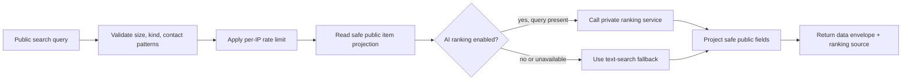

# Public discovery

Public endpoints expose only intentionally approved summary fields. Private report descriptions, direct contact details, claim information, evidence, and staff notes are not part of public listing responses.

| Method + path | Parameters | Behavior |
| --- | --- | --- |
| `GET /api/v1/institutions` | none | Active institution IDs, names, and regions, ordered by name |
| `GET /api/v1/institutions/{institutionID}` | path ID | One active institution's public name and region |
| `GET /api/v1/items` | optional `q` | Public listing with simple full-text query; maximum 100 rows |
| `GET /api/v1/items/search` | `q`, `kind`, `category`, `institution_id` | Filtered public search; `kind` is `lost` or `found` |
| `GET /api/v1/items/{itemID}` | path ID | One public-visible item; private/unapproved items are unavailable |

`/items/search` rejects malformed filters, contact details in the query, and overly long query/category/institution values. Public list/search requests are rate limited. Search may use the optional ranking service when enabled; otherwise it uses the API text-search behavior. The response identifies ranking source and can include a notice.

```bash
curl 'http://localhost:8080/api/v1/items/search?q=blue%20backpack&kind=found&category=Bags' \
  -H 'Accept: application/json'
```

Listing results contain safe fields such as item ID, institution ID/name, approved category/title/description/location, date, kind, and public status. The actual projection is in `publicItem` and the `public_items` database view.



The ranker does not grant access or confirm a match. It ranks data already eligible for public display; operational outcomes require staff decisions.
