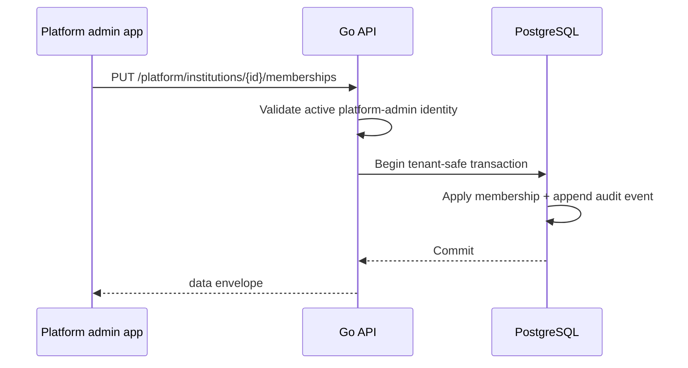

# Platform administration

All platform routes require an active platform-admin record, checked on each request. Institution staff membership is not sufficient. Administrative writes are audited transactionally.

| Method + path | Purpose |
| --- | --- |
| `GET /api/v1/platform/stats` | Platform summary counts |
| `GET /api/v1/platform/institutions` | List institutions including administrative state |
| `POST /api/v1/platform/institutions` | Create an institution |
| `PATCH /api/v1/platform/institutions/{institutionID}` | Update institution data or active state |
| `GET /api/v1/platform/institutions/{institutionID}/memberships` | List institution memberships |
| `PUT /api/v1/platform/institutions/{institutionID}/memberships` | Set or change a user's membership/role |
| `GET /api/v1/platform/admins` | List platform admins |
| `PUT /api/v1/platform/admins` | Grant/revoke platform-admin status |
| `GET /api/v1/platform/audit-events` | List platform audit events |

Membership roles represent institution staff/admin capabilities; inactive memberships do not grant access. Platform-admin changes use a transaction lock and cannot remove the final active platform administrator. Initial bootstrap is a protected owner/migration process, not a public unauthenticated endpoint.

Audit records are metadata about administrative actions. They must not include passwords, tokens, claimant statements, contact details, or evidence values.
