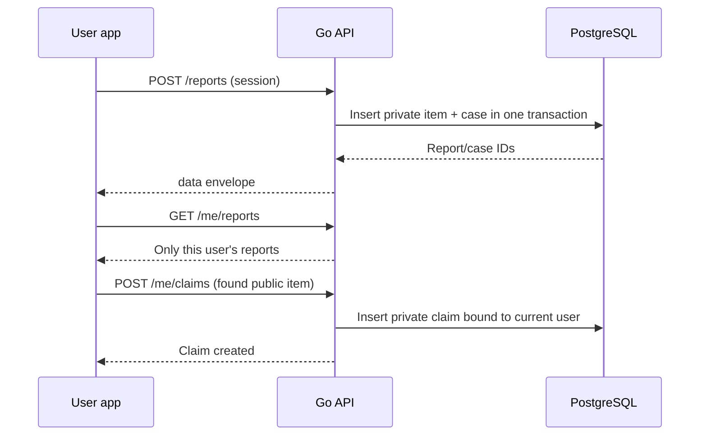

# User reports and claims

| Method + path | Purpose |
| --- | --- |
| `POST /api/v1/reports` | Submit a lost or found report to an active institution |
| `GET /api/v1/me/reports` | List reports owned by the authenticated user |
| `POST /api/v1/me/claims` | Submit a private claim to a found public item |
| `GET /api/v1/me/claims` | List claims owned by the authenticated user |

## Report submission

A report includes institution, lost/found kind, category, title, description, location, optional occurrence date, and private contact details. The API validates input, associates it with the signed-in user, and inserts item and case in one transaction. A new item is private and pending review. Report creation is rate limited per account.

```json
{
  "institution_id": "fictional-institution-id",
  "kind": "lost",
  "category": "Electronics",
  "title": "Fictional black headphones",
  "description": "A made-up example for local development.",
  "location": "Example library lobby",
  "occurred_on": "2026-01-15",
  "contact_details": "example-contact-kept-private"
}
```

Values are illustrative, not real contact information. Never include personal data in documentation examples.

## Claim submission

A claim targets a found item that is publicly visible. The claimant provides a private statement; contact details and evidence references remain staff-only. The API binds ownership to the authenticated account instead of trusting claimant identity from the client. Claim creation is rate limited. User history endpoints return only the current account's rows.



Validation and row ownership are enforced by handlers and database policies. Hiding another user's record in the UI is not the security boundary.
