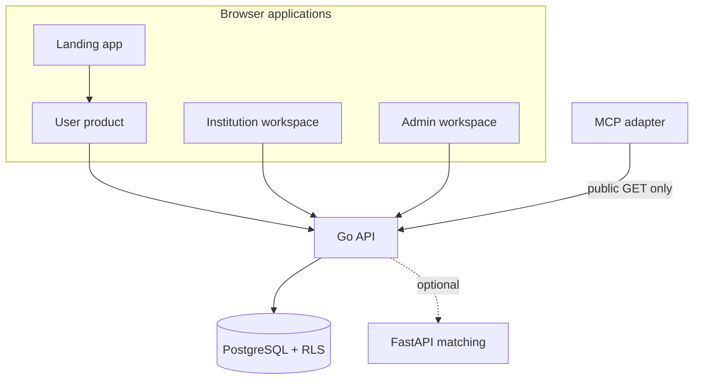
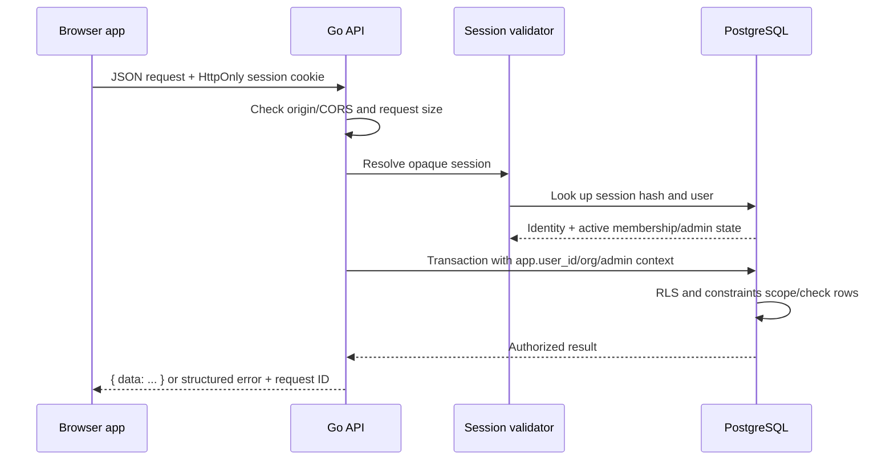

# Architecture and data model

## Runtime boundaries

VPK is a Next.js 16 monorepo backed by a Go HTTP API and PostgreSQL. The matching service is an optional private dependency. The MCP adapter is a separate read-only integration surface and should remain on a private network or local stdio transport.

The apps are separate Next.js deployments in the monorepo, but they share the same API identity and session. The landing app is informational; the user, institution, and admin apps make authenticated API calls from the browser.

## Request lifecycle

For cookie-authenticated writes, the API checks that the browser `Origin` is on the exact configured allowlist. Database work uses transaction-local settings for the user, selected institution, and platform-admin state; RLS policies then constrain rows even when a handler query is broad.

## Core entities

| Entity | Meaning | Privacy / ownership |
| --- | --- | --- |
| Institution | Organization that operates a staff workspace | Public directory exposes only active name and region; privileged settings remain staff/admin scoped |
| Membership | User's role in one institution | Tenant-bound; inactive membership grants no access |
| Platform admin | Explicit platform-wide admin grant | Separate from institution membership; checked on each request |
| Item | Lost or found record | Private source fields are distinct from approved public-safe fields |
| Case | Staff workflow around an item | Scoped to the owning institution; lifecycle tracked separately from item review |
| Claim | A user's claim to a found item | Statement, contact details, and evidence reference are private |
| Claim verification | Staff record of an approved claim verification step | Records method, note, and the exact claim review version verified |
| Handover | Staff-recorded return of an item | Private operational record; only created after verified approved claim |
| Audit event | Operational or platform-admin action | Stores action metadata, not sensitive claim contents or credentials |
| Auth session / token | Local identity and session lifecycle | Opaque browser cookie; only a hash of session secret is stored |

### Item visibility

A report begins as private and pending. Staff review can approve a public-safe projection or reject it. Only approved safe fields are served by the public listing view. Private descriptions, contact data, claimant statements, evidence references, and staff-only fields do not become public fields by omission in the client; the API query and projection deliberately select safe data.

### Database migrations

Migrations are ordered SQL changes in `services/api/migrations/`. They establish the original entities, local authentication, verified handover, audit events, platform administration, composite tenant relationships, and forced row-level security. `002_demo_seed.sql` intentionally does not populate synthetic production-looking records. Read the migration sequence before changing entity constraints or authorization assumptions.

## Roles and authorization

- Anonymous callers can read safe public listings and active institution directory data, subject to rate limits.
- A signed-in user can manage only their own reports and claims.
- Institution staff need an active membership in the institution in the route and request context. `institution_admin` includes staff capabilities.
- Platform admins require an active platform-admin record and can perform platform-scoped administration.
- The local demo role selector can change the UI preview, but it cannot grant API permissions.

Authorization is layered: handler identity checks, institution membership/admin checks, transaction context, forced RLS, foreign keys, and database triggers/constraints for critical state transitions.
