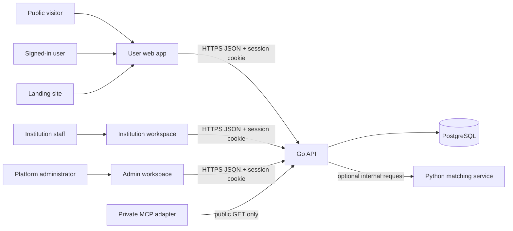

# Vilivyopotea na Kupatikana

This section documents the VPK lost-and-found platform implemented in the VPK repository. It covers the web applications, Go API, PostgreSQL data and authorization model, private Python match-ranking service, and read-only MCP adapter.

> **Pre-pilot status:** examples use fictional records. Documentation does not imply that a university or other institution has approved a pilot. The app's demo role selector is not an authorization mechanism; the API and database enforce access.

## Start with the system map

## Documentation map

- [Architecture and data model](/architecture) explains service boundaries, entities, tenant scoping, and request context.
- [Application integration](/apps) maps each app screen/action to API operations.
- [Go API reference](/api) is the complete route inventory and protocol guide.
- [Service reference](/services) documents the Go, Python, and MCP services.
- [Workflows and algorithms](/workflows) traces reporting, claims, handover, matching, and administration.
- [Security and operations](/security) covers identity, database policies, privacy, rate limits, deployment boundaries, and observability.

## Repository locations

| Area | Source |
| --- | --- |
| User product and internal developer docs | `src/app/`, `src/components/vilivyopotea/`, `src/lib/api.ts` |
| Public landing app | `apps/landing/` |
| Institution staff app | `apps/institution/` |
| Platform administration app | `apps/admin/` |
| Go API | `services/api/` |
| Private matching service | `services/ai/` |
| Read-only MCP adapter | `services/mcp/` |
| Database migrations | `services/api/migrations/` |
| Compose and local stack | `compose.yaml`, `Makefile`, `.env.example` |

## Scope and source of truth

These guides explain implemented behavior, not a promise of production readiness or a public service-level guarantee. Route registrations live in `services/api/internal/api/server.go`; request validation and business rules live in the registered handlers and store; the migration files define database constraints and RLS. When documentation and implementation differ, the code and applied migrations are authoritative. All example IDs, people, institutions, and claims are fictional.
