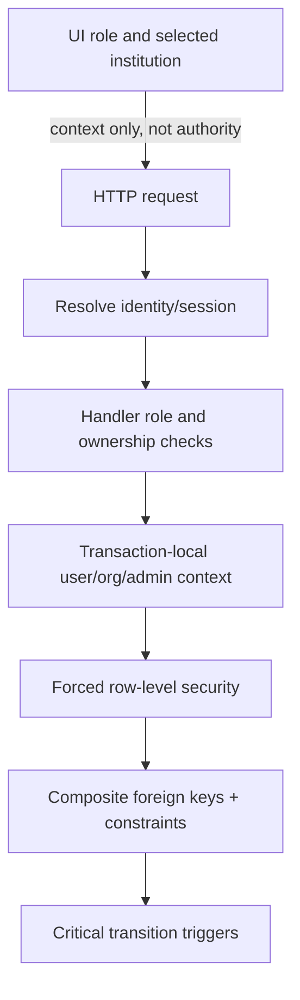

# Security and operations

## Identity and browser protections

- Local accounts use bcrypt password hashes and opaque, hashed session secrets.
- Browser session cookie: `__Host-vp_session`, HttpOnly, Secure, SameSite=Lax, Path `/`, no Domain; 30-day expiry.
- Cookie-authenticated writes require an allowed `Origin`; CORS uses an exact origin allowlist and credentials only for allowed origins.
- Forwarded client IP is trusted only when the connecting proxy is in configured trusted CIDRs. The trusted proxy must overwrite forwarded headers.
- Password reset revokes sessions; verification and reset secrets are single-use hashed tokens.
- No production mail provider is implied: notifications are currently represented by a local outbox in development.

## Layered authorization

Institution endpoints require an active membership in the path institution. Platform routes require an active platform-admin record. The application database role is neither owner nor RLS bypass. These layers prevent the demo role selector, modified frontend requests, or broad queries from becoming authorization.

## Privacy boundaries

- Public listings read from a safe projection containing only approved fields.
- Private claimant statements, contact details, evidence references, and staff notes remain staff-only.
- Matching requests should contain bounded item descriptors only; never forward claimant PII.
- MCP exposes public read-only projections only.
- Audit events record actor/action/target metadata, not tokens, passwords, claimant text, or evidence.
- Logs omit request bodies, secrets, IP addresses, query strings, and personal data; route dimensions remain coarse.

## Current API rate limits

The implementation uses PostgreSQL-backed hashed rate-limit keys so limits are shared across API instances. Current defaults:

| Operation | Limit |
| --- | --- |
| Registration | 5 per IP per hour |
| Login | 25 per IP per 15 minutes; 6 per account per 15 minutes |
| Verify email | 10 per IP per 15 minutes |
| Verification resend | 5 per IP per hour; 3 per email per 15 minutes |
| Password reset request | 5 per IP per hour; 3 per email per 15 minutes |
| Password reset confirm | 10 per IP per hour |
| Public item listing | 120 per IP per minute |
| Public search | 60 per IP per minute |
| Report submit | 10 per account per hour |
| Claim submit | 5 per account per hour |
| Staff match shortlist | 10 per account + institution per 15 minutes |

These are current implementation defaults, not an SLA. Re-check rate-limit code before capacity planning.

## Operations and deployment

- `/healthz` is process liveness; `/readyz` checks database availability.
- `/metrics` is process-local and should only be reachable on internal monitoring networks.
- PostgreSQL must not be publicly exposed. Web apps call the Go API; the API alone reaches the database and optional ranker.
- Matching is disabled by default. Keep AI token and local model path server-side.
- MCP is optional, read-only, and should stay on private network or stdio.
- Use VPK `.env.example` and `docs/deployment.md` for configuration and production overlay behavior. Never commit real secrets.

## Pre-pilot boundaries

Use fictional data in local environments and demonstrations. The repository does not imply institutional approval, adoption, or a live pilot. Do not describe the service as an official institution system without explicit external authorization and deployment evidence.
