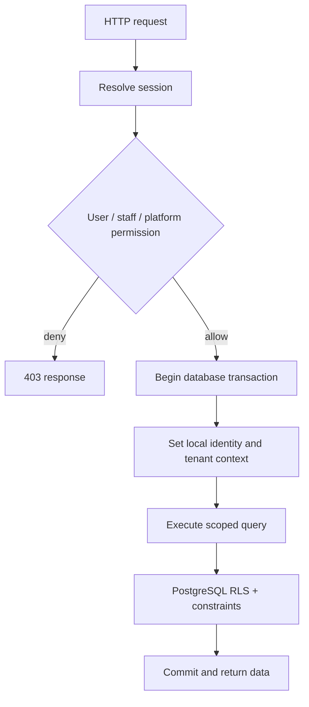

# Go API and PostgreSQL

## Code map

- `services/api/cmd/` starts the service and wires config, database, auth, middleware, and API server.
- `services/api/internal/api/` registers HTTP routes and implements handlers, response envelopes, metrics, rate limits, and request validation.
- `services/api/internal/auth/` validates local sessions and creates secure cookie behavior.
- `services/api/internal/store/` owns PostgreSQL pool setup and transaction context helpers.
- `services/api/migrations/` is the schema and database-policy source of truth.

The route table is documented at [Go API reference](/api). New handlers should keep authorization checks close to the data operation and use tenant-aware transaction helpers.

## Tenant context and RLS

The application database role is not the schema owner, is not superuser, and has no `BYPASSRLS`. Tenant tables use forced row-level security. Before tenant work, the API sets transaction-local values such as `app.user_id`, `app.institution_id`, and `app.platform_admin`. Policies use these values to constrain reads/writes. Composite foreign keys tie tenant-owned records to the same institution, while triggers constrain sensitive transitions such as handover.

Transaction-local scope is important: pooled PostgreSQL connections are reused, so tenant context must not leak between requests. Use local settings in a transaction, never persistent session settings on a pooled connection.

## Atomic transitions

- Report creation inserts the item and case atomically.
- Claim review records status and staff review metadata together.
- Claim verification is tied to the exact approved review timestamp.
- Handover atomically inserts the private handover record, marks case/item returned, and audits the action after verifying a matched case, current approved and verified claim, and no prior handover.
- Platform admin/member changes and their audit events commit together.

These rules are duplicated deliberately where appropriate between handler checks and database constraints. Database constraints protect invariants from alternate query paths and races.

## Migrations

| Migration | Purpose |
| --- | --- |
| `001_initial.sql` | Institutions, memberships, platform admins, items, cases, claims, handovers |
| `002_demo_seed.sql` | Intentionally empty; no synthetic sample data is seeded |
| `003_local_auth_and_handover.sql` | Local users, auth sessions/outbox, handover additions |
| `004_identity_hardening.sql` | Verification/reset tokens and rate-limit hardening |
| `005_database_tenant_isolation.sql` | Composite tenant relations, remove legacy exact sample rows, RLS |
| `006_verified_handover.sql` | Claim verification, triggers, and handover policies |
| `007_operational_audit.sql` | Tenant operational audit events |
| `008_platform_administration.sql` | Platform audit events, admin RLS management, audit visibility |

Always review migrations in sequence against the checked-in directory; deployments may be on different migration levels.

## HTTP behavior

- Go 1.22 method-aware `ServeMux` route patterns.
- Request IDs are attached to responses; structured error bodies use stable codes.
- JSON request body cap is 1 MiB.
- CORS uses exact configured origins, credentials, and explicit methods/headers.
- Metrics include process-local low-cardinality counters and durations; do not publish `/metrics` to the internet.
- Logs avoid request bodies, tokens, IPs, query strings, and sensitive personal data; route labels are coarse.
