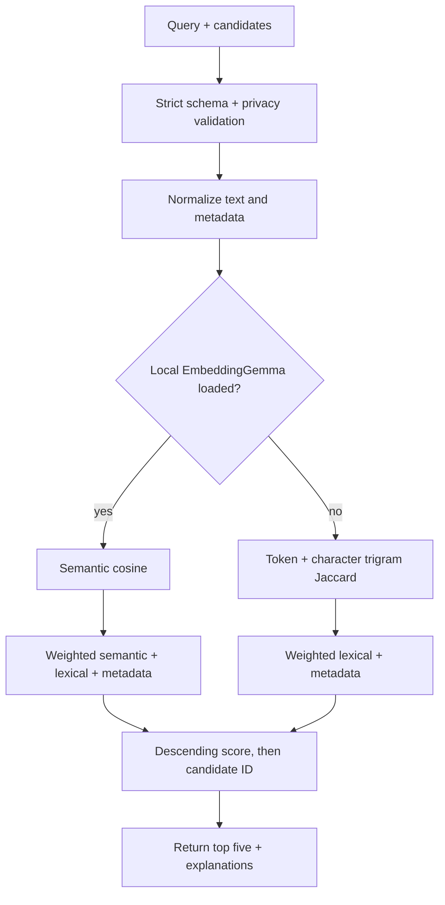

# Matching service and ranking algorithm

The Python service in `services/ai/` returns a ranked shortlist. The Go API decides which candidates are eligible and remains responsible for user/staff authorization. A score is a ranking signal, not a probability, identity proof, or decision.

## HTTP contract

| Method + path | Purpose |
| --- | --- |
| `GET /healthz` | Process health |
| `GET /readyz` | Model/service readiness |
| `POST /v1/matches` | Rank one query record against candidate records |

When configured, requests require `Authorization: Bearer <AI token>`. Production configuration can require a token. The service has no database or vector store. Embeddings are computed in process and not persisted; no external inference call or image analysis is performed.

The request contains a query item and candidate list. `record_id` is limited to 1–64 characters matching `[A-Za-z0-9_-]`; category is at most 80 chars, description 500, and location 120. Additional fields are rejected. Contact-like email and phone values are rejected. Candidate count is capped at 1,200; request body is capped at 1 MiB and request timeout is 60 seconds. Output is capped at five results. Invalid input returns a generic 422 message without reflecting submitted values.

## Candidate eligibility is in Go

For staff suggestions, Go filters records to the same institution, opposite item kind (lost vs found), public-approved, not closed or returned, optional exact category, and optional date distance. The candidate limit is 1,200. The private ranker does not receive arbitrary database access. If the matching service is disabled or unavailable, Go falls back to PostgreSQL text search.

For public search, the API starts from the safe public listing projection. AI ranking is off by default (`AI_MATCHING_ENABLED=false`).

## Ranking features

Text is normalized into token sets. The lexical score combines word overlap and character-trigram overlap:

`lexical = 0.65 × token Jaccard + 0.35 × trigram Jaccard`

Metadata score combines category, date, and location:

`metadata = 0.50 × category overlap + 0.25 × date similarity + 0.25 × location overlap`

Date similarity decreases linearly to zero across a 31-day gap:

`date similarity = max(0, 1 - day_gap / 31)`

Fallback score:

`score = 0.70 × lexical + 0.30 × metadata`

When the local EmbeddingGemma 2 checkpoint is loaded:

`score = 0.60 × semantic cosine + 0.25 × lexical + 0.15 × metadata`

Semantic cosine is clamped to `[0, 1]`. The model is loaded once at startup from `EMBEDDINGGEMMA_MODEL_PATH`, uses local-only model files, float32 inference, and distinct `SearchQuery`/`Document` prefixes. An explicitly configured invalid path fails startup; it does not trigger a download. `EMBEDDINGGEMMA_REQUIRED=true` prevents fallback startup without the checkpoint.



The exact feature explanations identify signals such as category overlap; they do not claim certainty. Scores are uncalibrated. Sorting uses descending score and then candidate ID for deterministic ties. Staff must independently verify ownership and follow institution process.

## Configuration and privacy

- `AI_MATCHING_ENABLED` is false by default.
- `AI_SERVICE_TOKEN` authenticates Go-to-AI calls; do not expose it to web apps.
- `EMBEDDINGGEMMA_MODEL_PATH` points at a local checkpoint; no automatic download.
- `EMBEDDINGGEMMA_REQUIRED` controls fail-fast behavior when a checkpoint is mandatory.
- Do not send claimant statements, contact data, or staff notes to this service. Inputs are minimal item descriptions/category/date/location and bounded candidates.

## Internal request shape

The Go API calls the ranker over the private service network. The token is a server-to-server credential and must never be included in a browser app or public example.

```http
POST /v1/matches
Authorization: Bearer <server-side AI_SERVICE_TOKEN>
Content-Type: application/json
```

```json
{
  "query": {
    "record_id": "fictional-query-1",
    "kind": "lost",
    "category": "Bags",
    "description": "Blue backpack with a stitched patch",
    "location": "Main library area",
    "occurred_on": "2026-01-15"
  },
  "candidates": [
    {
      "record_id": "fictional-candidate-2",
      "kind": "found",
      "category": "Bags",
      "description": "Blue backpack with small patch",
      "location": "Library entrance",
      "occurred_on": "2026-01-16"
    }
  ]
}
```

The response contains a ranking identifier and up to five records with candidate IDs, rank/score, and explanation strings. The Go API uses those IDs to construct the caller-appropriate projection; the model service is not a direct browser API.
