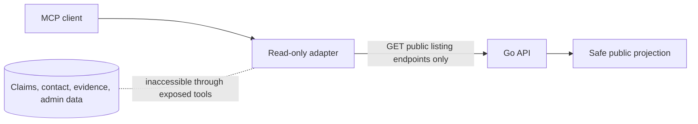

# Read-only MCP adapter

`services/mcp/server.py` wraps a small subset of the public Go API for Model Context Protocol clients. It is intentionally read-only and must not be treated as a trusted staff or user API.

## Tools and resource

| Name | Input | Upstream call | Returned fields |
| --- | --- | --- | --- |
| `search_public_listings` | query length 2–120; limit 1–25 | `GET /api/v1/items?q=...` | Safe listing projection, bounded strings |
| `get_public_listing` | item ID 1–80 chars under strict ID validation | `GET /api/v1/items/{id}` | One safe public listing |
| `list_active_institutions` | none | `GET /api/v1/institutions` | Institution ID, name, region |
| `vilivyopotea://safe-use` resource | none | Local guidance | Privacy and intended-use boundaries |

Search rejects email-like values, long digit sequences that resemble phone numbers, and URLs. Results are projected from an allowlist: ID, title, category, kind, status, institution name, description, approximate area, and date, with field-length caps. MCP clients do not receive private claim details, contact details, evidence, staff notes, or admin records.

## Deployment boundary

The adapter reads `VILIVY_API_BASE_URL` and has a short upstream timeout (4 seconds). stdio is the default transport. Optional HTTP transport binds to loopback by default; Compose uses a private internal profile/network and should not publish a public port. The service does not implement its own authorization, so its deployment boundary is essential.

Do not add mutation tools or call staff/platform routes from this adapter. Keep tool outputs minimal and treat external model clients as untrusted recipients of public listing data.
