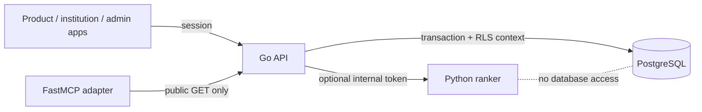

# Service reference

| Service | Runtime | Responsibility | Network boundary |
| --- | --- | --- | --- |
| API | Go `net/http`, pgx | Identity, authorization, domain workflows, public projections, platform administration | Browser-facing API; database and optional AI private |
| Matching | Python FastAPI | Rank candidate records from a bounded request | Internal only; bearer token required when configured and required in production |
| MCP adapter | Python FastMCP | Expose safe public search/read tools to MCP clients | Private Docker network or local stdio; read-only |
| PostgreSQL | PostgreSQL | Durable identity, tenant data, constraints, RLS, audit, rate counters | Internal network; not exposed to public clients |

The Go API is the authority for identity, access, and state changes. The matching service supplies rankings only. MCP is an adapter to the public listing surface, never a path to private claims or writes.

See the detailed [Go API and PostgreSQL](/services/go-api), [matching algorithm](/services/matching), and [MCP adapter](/services/mcp) guides.
