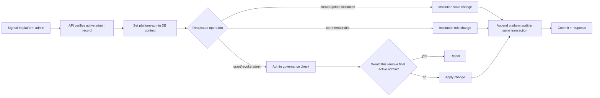

# Platform administration workflow

Routes are under `/api/v1/platform/`. Every request checks an active platform-admin row. Institution memberships are managed separately and do not imply platform access. Admin modifications use a transaction-level lock to serialize last-admin checks. A change and its audit event commit together. Initial platform-admin bootstrap is a protected deployment/migration task, not an open route.
