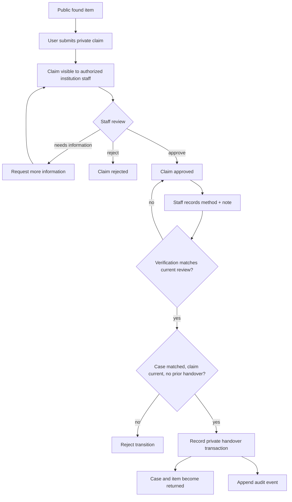

# Claim to verified handover

A claim is submitted against a found public item. The claimant statement and contact/evidence fields are private. Staff review decisions are `approved`, `rejected`, or `needs_information`; review note and timestamp are recorded with the decision.

Verification is a separate step after approval. Supported methods are `in_person`, `video_call`, `document_review`, and `other`; a note must be 8–2000 runes. Verification stores the reviewed timestamp it applies to. If staff changes the claim decision afterward, the old verification no longer qualifies.

Handover requires all of the following at commit time:

1. The case belongs to the requested institution and is in `matched` state.
2. The claim belongs to the found item attached to that case.
3. The claim is currently approved and has valid verification for its current review.
4. The case/item has not already been handed over.
5. Database constraints and triggers accept the transition.

The transaction creates the handover record, updates case/item state, and appends an operational audit event atomically. Failure of any precondition leaves no partial return state.
