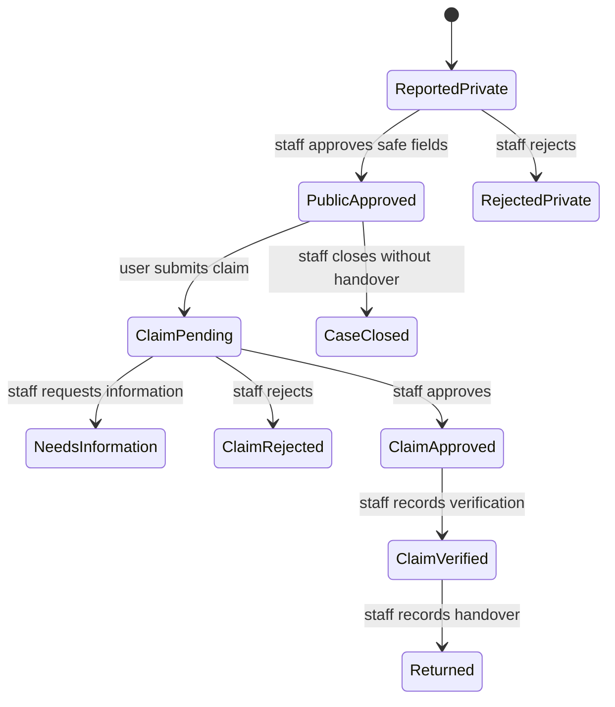

# Workflow guides

These workflows describe behavior implemented by the API and database. A UI step is never proof of authorization; every operation is checked by the API and database.

- [Report to public listing](/workflows/report-to-public-listing)
- [Claim to verified handover](/workflows/claim-to-handover)
- [Match suggestions](/workflows/matching)
- [Platform administration](/workflows/administration)

A returned item is reached through the dedicated handover transition. It cannot be set by editing case status directly.
