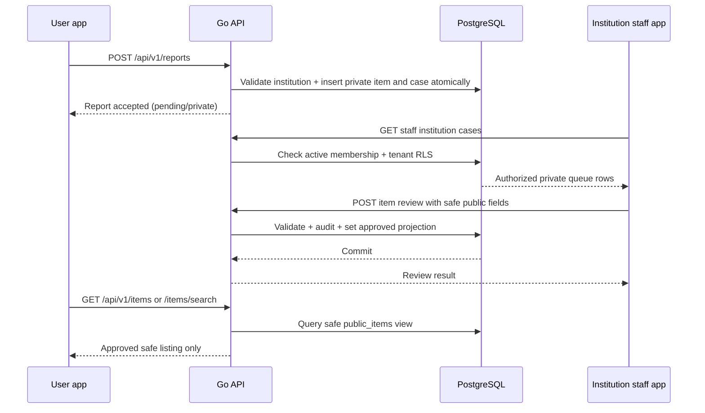

# Report to public listing

Report insertion creates item and case in one database transaction. The private source description and contact information are not automatically copied to public fields. Staff explicitly supplies approved public title, description, and location; contact patterns and unsafe field limits are rejected. Rejection leaves the item private. The public API reads from the safe view and cannot expose unreviewed records.

## Operational notes

- Report submitters must be signed in and own their report history.
- Only active institution staff can see the private queue.
- Review writes are audited without copying sensitive text into audit metadata.
- Public listing is a separately selected projection, not a frontend filter over private records.
